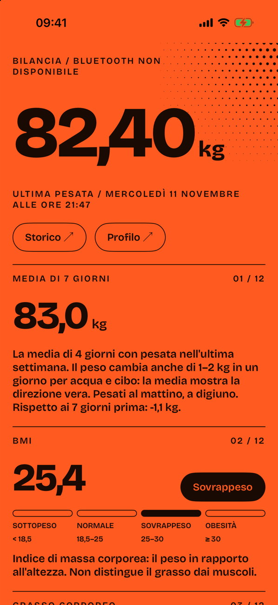
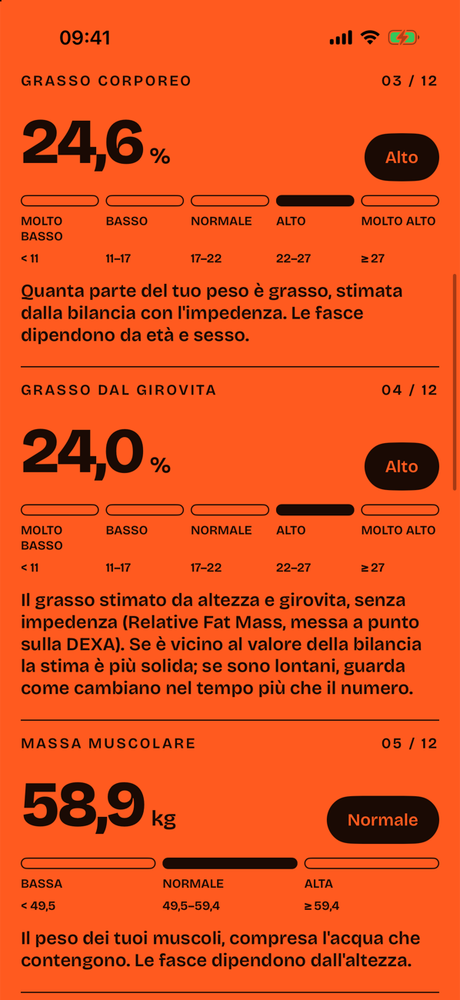
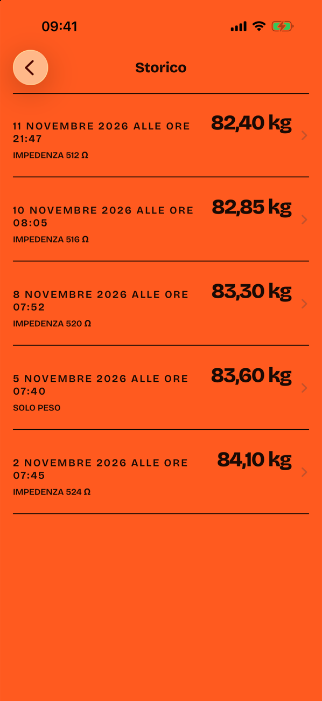
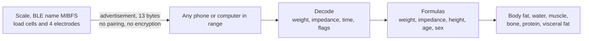

<p align="center"></p>

<h1 align="center">Mi Scale 2</h1>

<p align="center">
The Xiaomi Mi Body Composition Scale 2, taken apart from the outside:<br>
what it says over Bluetooth, how Zepp Life turns that into body fat and muscle,<br>
and two programs that read the scale without the vendor app, an account or a cloud.
</p>

<p align="center">



</p>

## What is in here

| Part | File | What it is |
|---|---|---|
| Reverse engineering | [REPORT.md](REPORT.md) | The Bluetooth record, the GATT services, the history download and every formula, each marked as read in the code, inferred or unknown |
| Reader | [scale.swift](scale.swift) | One file, no dependencies. Run it on a Mac, step on the scale, get the numbers Zepp Life would show |
| iPhone app | [ios/](ios) | **Bilancia**: reads the scale, keeps every weigh-in on the phone, explains each value in plain Italian |

Nothing from the vendor is in this repository: no APK, no decompiled code, no native library. The report gives hashes so you can get the same file and check every claim yourself.

## How the system works



The scale is a simple device. It measures two things, your weight and the electrical resistance between your feet (impedance), and broadcasts them to anyone listening. It knows nothing about you. Everything else is arithmetic done on the phone.

Three facts follow from that:

- **Anyone nearby can read your weight.** The broadcast is not encrypted and needs no pairing.
- **The scale works without Zepp Life.** A listener that knows the 13-byte layout gets the same raw data the app gets.
- **"Body composition" is an estimate.** The scale measures two numbers; fat, water, muscle and bone are fitted formulas of those two plus height, age and sex.

### The 13 bytes

```
02 a6  ea 07  0b  0b  14 2f 37  00 02  60 40
│  │   └─┬─┘  │   │   └──┬───┘  └─┬─┘  └─┬─┘
│  │   year  month day  h m s   imped.  weight
│  │   2026   11   11  20:47:55  512 Ω  16480 ÷ 200 = 82.40 kg
│  └ flags: 0x02 impedance present, 0x20 weight stable, 0x80 finished
└ flags: 0x01 unit is lbs
```

The layout was confirmed on a real scale; weight and impedance in this example are made up. The full layout, the unit handling and the open questions are in [REPORT.md, section 3](REPORT.md#3-the-13-byte-measurement-record).

## How it was reverse engineered

1. **Get the app.** Zepp Life 6.17.0 for Android, checked against the Huami signing certificate before opening it.
2. **Read, never run.** The app was only analysed statically: Java decompiled with [JADX](https://github.com/skylot/jadx), the native library `libBodyfat.so` disassembled for arm64. It was never installed or executed.
3. **Follow the data.** From the Bluetooth scan callback to the record parser, then to the class that picks the algorithm, then into the native library function by function.
4. **Write the formulas down** with the address of each function, and compare them with the community ports. Three differences turned up ([section 9](REPORT.md#9-differences-from-the-community-ports)).
5. **Check on hardware.** The decoder was run against a real scale and the layout held.

What the report does not claim: the body-composition output has not yet been compared with Zepp Life's screen for the same weigh-in, and several configuration commands are still unexplained. The list is in [section 11](REPORT.md#11-what-is-still-unknown).

## The reader

```bash
swift scale.swift --height 175 --age 35 --sex m
```

Run it from Terminal on macOS (the first run asks for Bluetooth permission), then step on the scale. Without the three options it prints weight and impedance only.

```bash
swift scale.swift --selftest
```

checks the decoder and every formula against values worked out by hand from the report.

## The iPhone app

Bilancia listens while it is open, stores each stable weigh-in with its raw packet, and shows every value with its range and one sentence on what it means.

It does not copy Zepp Life everywhere. Where a published, peer-reviewed equation exists, the app uses it:

| Value | Source | Why |
|---|---|---|
| Body fat, water, muscle, bone, protein | Zepp Life's formulas | They are fitted to this scale's electrodes; no public equation is |
| Basal metabolism | Mifflin-St Jeor | The vendor formula has no published validation |
| Healthy weight | BMI 18.5–25 for your height | A range, not the single "standard weight" |
| Fat from waist | Relative Fat Mass | A second estimate that does not depend on impedance |
| Waist-to-height ratio | Cuts at 0.5 and 0.6 | Replaces the vendor's visceral fat score when you enter your waist |
| 7-day average | One value per day | Daily weight moves 1–2 kg with water and food |

"Body age" is left out: it has no physiological meaning. Under 18, the adult equations are hidden.

### Build

Needs Xcode 26 and an iPhone on iOS 26.

```bash
cd ios && open Bilancia.xcodeproj
```

Set your own team under Signing, pick your iPhone, run. To change project settings edit `ios/project.yml` and run `xcodegen`.

The simulator has no Bluetooth. Launch with the argument `-sample` to load a made-up history through the same code path as real packets.

| File | Role |
|---|---|
| [Scale.swift](ios/Bilancia/Scale.swift) | Packet decoder, formulas, ranges, self-check (runs at every debug launch) |
| [Store.swift](ios/Bilancia/Store.swift) | Bluetooth listener and SwiftData storage |
| [Views.swift](ios/Bilancia/Views.swift) | Home, history, detail, profile |
| [Theme.swift](ios/Bilancia/Theme.swift) | Colours, type, shared components |

## Limits

- Not a medical device and not medical advice. Impedance from foot to foot is a rough estimate of body composition; trust the trend more than any single number.
- iOS does not deliver these broadcasts to an app in the background, so Bilancia reads only while open.
- Weigh-ins the scale stored while no one was listening are not downloaded. The protocol is documented ([section 5](REPORT.md#5-history-download)) but not implemented.
- Tested on one scale.

## Legal

Code and text are under the [MIT licence](LICENSE). Independent interoperability research. Not affiliated with Xiaomi, Huami or Zepp Health; all trademarks belong to their owners. The Bricolage Grotesque font is distributed under the SIL Open Font License.
